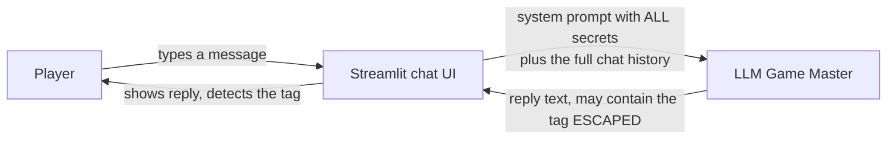
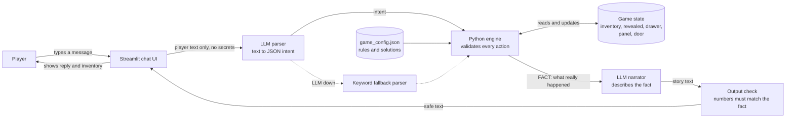

# Architecture diagrams

GitHub renders these Mermaid diagrams directly. To get PNG images for the report,
paste each block (without the ```mermaid lines) into https://mermaid.live and download the image.

## Version 1: the LLM does everything



The LLM holds the codes, decides what works, and is the only memory of the game.
Weak points: it can leak the codes, forget earlier actions, invent objects, and be talked into anything.

## Version 2: Python owns the rules, the LLM only talks



The LLM never sees the codes and cannot change the game state.
Only the Python engine can set `door_open = True`.
If the LLM is down, a keyword parser and plain facts keep the game playable.
